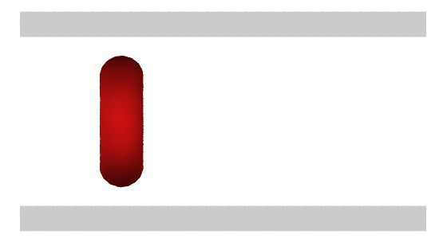

# 03_channel: a cell in pressure-driven flow

A red cell between two walls 10 um apart (box 24 x 16 x 13 um, periodic
in x and y, 20,483 particles). A body force f = 1.0 on every solvent
particle drives the flow along x, as a pressure gradient would. The cell
starts at mid-height as a disk facing the flow. It bends into a
parachute and is carried along the middle of the channel.

<p align="center"></p>

```
python3 make_data.py
../../build/lmp -k on g 1 -sf kk -pk kokkos newton on neigh half -in in.channel
python3 analyze.py
```

The run is 100,000 steps (14 ms). Run times are in the main README.

## What to expect

`analyze.py` printed, for one of our runs:

```
cell speed (second half of the run) 0.2122 = 1.52 mm/s
height of the cell center: start 6.50, end 6.48 (channel center 6.5)
area change +0.28 %, volume change -0.36 %
cell size at step 100000: 4.52 (x, flow) x 8.21 (y) x 6.28 (z) um
```

The cell is shorter across the channel (z) than along the walls (y):
the flow changes only with z, so only that direction is bent.

## Output

| File | Content |
|---|---|
| `cell.txt` | step, center of the cell (x, z), its speed, area and volume, every 1000 steps |
| `cell.lammpstrj` | vertex positions, every 2000 steps |
| `channel.restart` | the final state |

The positions in `cell.lammpstrj` are unwrapped, so the cell reaches the
end of the 24 um box after about 75,000 steps; wrap them (in OVITO, Wrap
at periodic boundaries) to keep it in view.

## Try

- Change the flow with `-var f 0.5`; without the cell, the flow speed is
  proportional to f (see `02_poiseuille`).
- Start the cell off the center line (`center=` in `make_data.py`) and
  follow its height, `z_center` in `cell.txt`.
